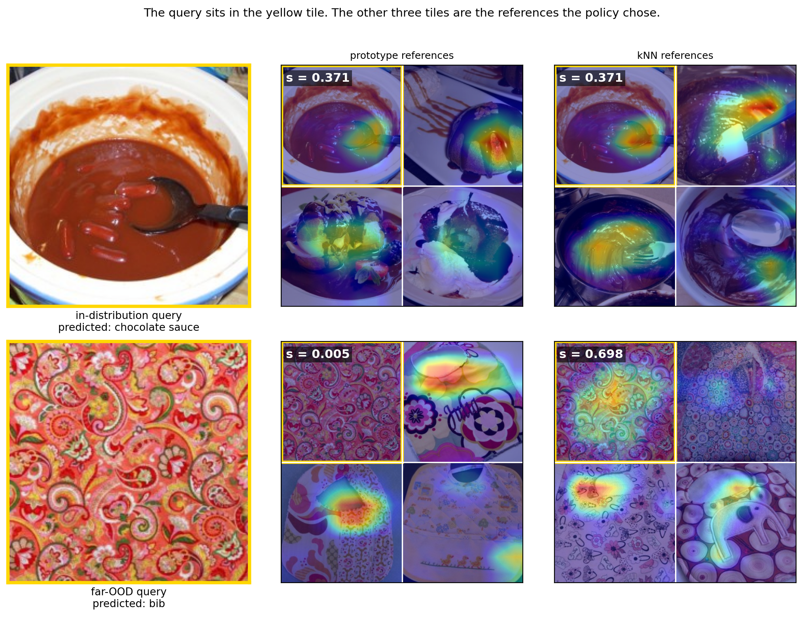
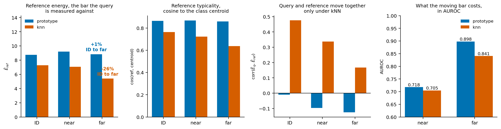

# Why the kNN exemplar policy loses to the fixed prototypes

The design ablation in the paper compares reference policies. The
query-adaptive kNN policy loses to the fixed prototype policy, and the loss is
concentrated in far-OOD. This note measures why.

Deck for the same material: [`knn_vs_prototype.pptx`](knn_vs_prototype.pptx).

## The two policies

Both are defined in `src/exemplars.py` in the frozen repository and both are
pure operations on the pooled features.

| policy | selection rule | depends on the query |
|---|---|---|
| `prototype` | the 3 training images nearest the class centroid, by cosine | no |
| `knn` | the 3 training images nearest the query, by cosine | yes |

## What the score hides

The score is a ratio:

```
s = E_q / (E_q + E_ref)
```

`E_q` is the mean attribution energy on the query tile and `E_ref` is the mean
over the three reference tiles. The ablation table reports only `s`, so it
cannot show whether a loss comes from the query term or from the reference
term. Both are measured here on the same query, under both policies.

## The example



The query sits in the yellow tile. The other three tiles are the references
the policy chose. The heatmap is the Grad-CAM of the predicted class, computed
over the whole mosaic in one forward pass.

The bottom row is a paisley texture from Textures, predicted as *bib*. Under
`prototype` the references are ordinary bibs, the query tile stays dark, and
`s = 0.005`. Under `knn` the references are three heavily patterned bibs,
selected because they resemble the paisley, and the same query tile lights up
to `s = 0.698`.

The top row is the control. For an in-distribution query both policies return
`s = 0.371`. The reference policy does not matter when the query belongs to the
class.

## The measurement



ResNet-50 trained from scratch on ImageNet-1K with cross-entropy, 1,000 queries
per set, seed 0, OpenOOD v1.5 splits.

| | `E_q`, ID to far | `E_ref`, ID to far | `s`, ID to far |
|---|---|---|---|
| `prototype` | 4.60 to 0.74, **-84%** | 8.74 to 8.83, **+1%** | 0.325 to 0.076 |
| `knn` | 5.38 to 1.51, -72% | 7.28 to 5.40, **-26%** | 0.405 to 0.203 |

Under `prototype` the reference term is flat across ID, near-OOD and far-OOD.
The query falls 84 percent against a bar that does not move, so the ratio falls
with it.

Under `knn` the reference term falls 26 percent from ID to far-OOD. The query
falls and the bar falls with it, so the ratio cancels half the drop.

The reason the bar moves is in the selection. For an OOD query the nearest
same-class neighbours are the atypical members of the class, and atypical
members carry less class evidence.

| | cos(reference, class centroid), ID to far |
|---|---|
| `prototype` | 0.86 to 0.86 |
| `knn` | 0.76 to 0.64 |

The correlation closes the argument. `corr(E_q, E_ref)` is **+0.48** under `knn`
and **-0.01** under `prototype`. A reference that correlates with the query does
not measure the query.

The cost is 5.7 AUROC points in far-OOD: 0.898 under `prototype` against 0.841
under `knn`.

## Reproducing

```
$PYTHON_BIN note_knn_code/knn_vs_prototype.py --n 1000
$PYTHON_BIN note_knn_code/knn_slides.py --ood textures
$PYTHON_BIN note_knn_code/knn_deck.py
```

Script 169 needs `CE_CKPT`, `CE_FEATDIR`, `IN1K_TRAIN`, `IN1K_VAL` and the five
OOD set variables from `.env`. It writes a per-sample CSV with `E_q`, `E_ref`,
`s` and the three selection diagnostics, one row per query and policy.
`169_resumo.csv` here is the aggregate from that run.

The numbers above come from 1,000 in-distribution queries and one query
position. The ablation table in the paper uses 10,000 in-distribution queries
and averages the four positions, which is why it reports 0.904 and 0.861 where
this note reports 0.898 and 0.841. The gap between the policies is the same in
both.
