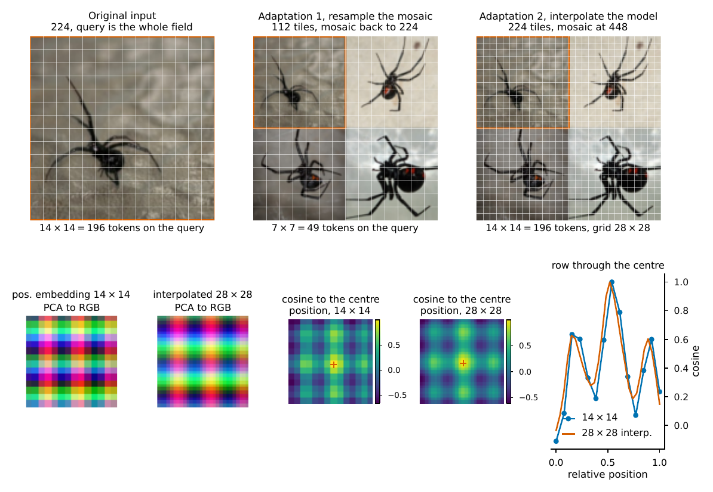
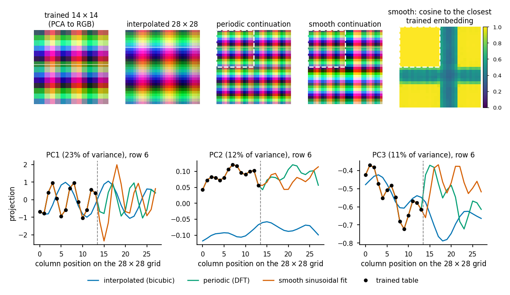
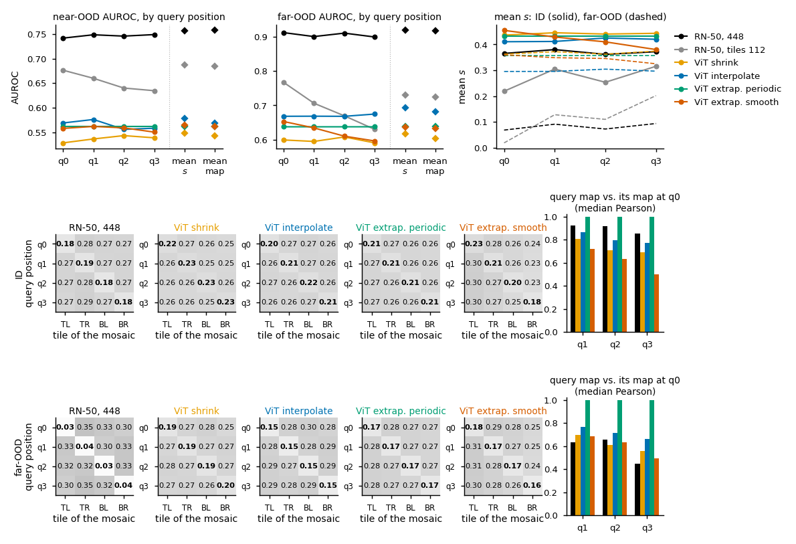
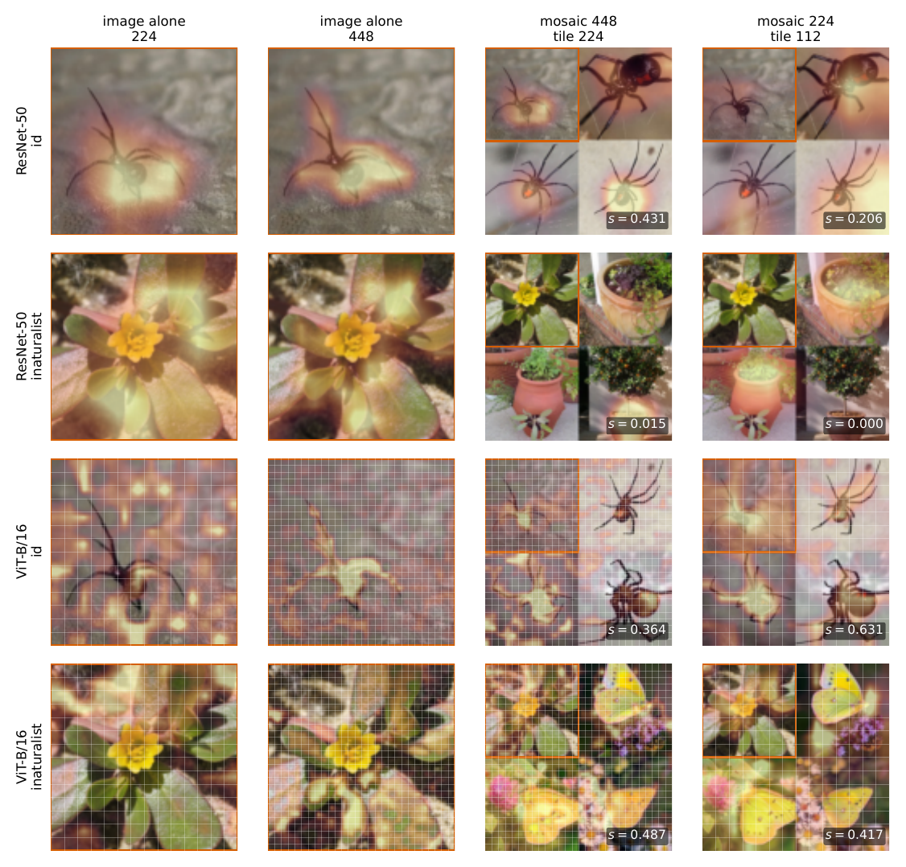
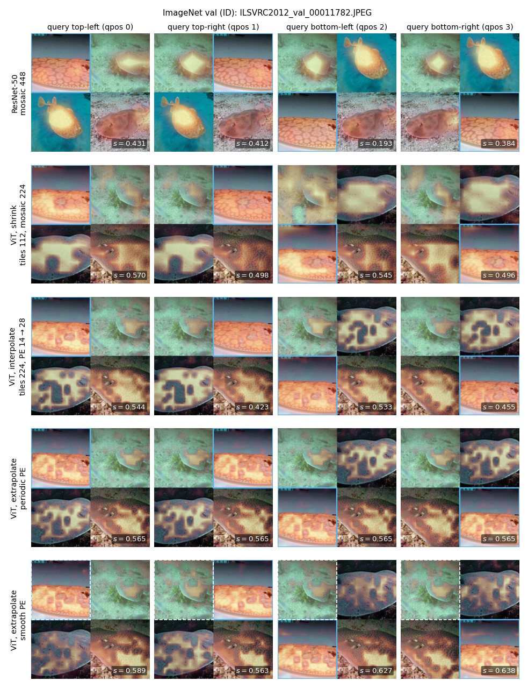
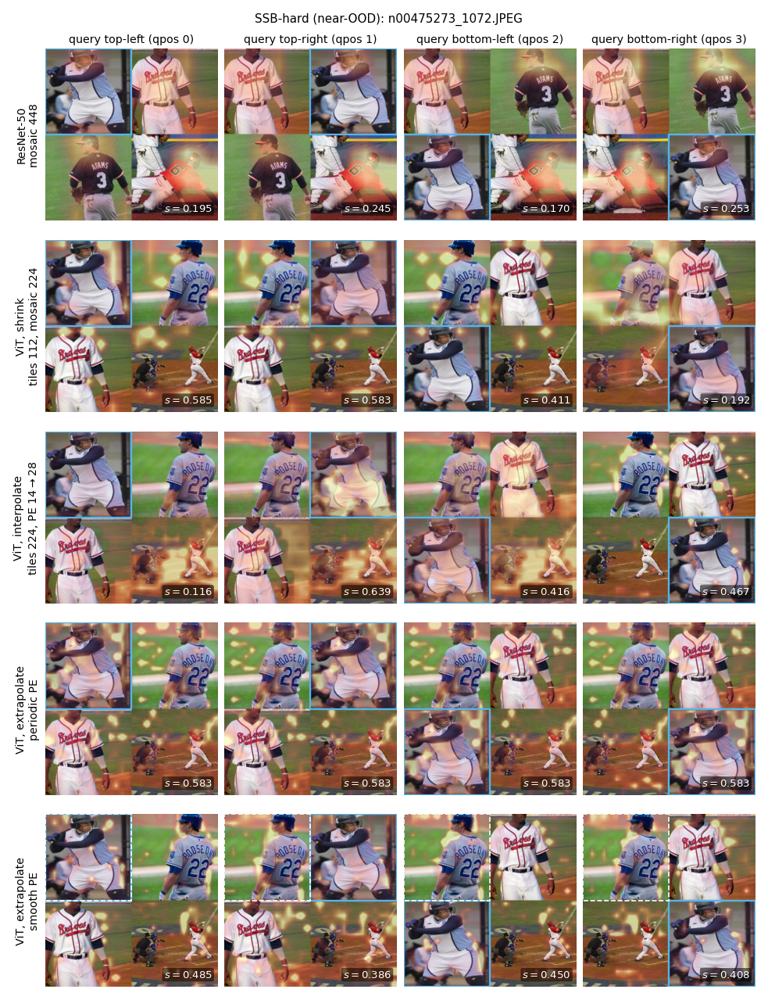
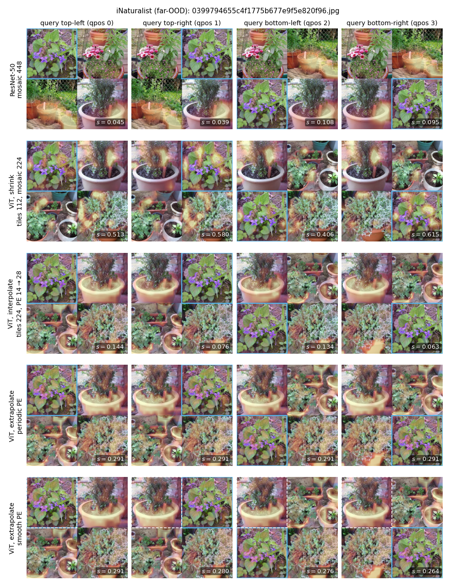

# Transformer backbones in the mosaic

Supplementary material of the paragraphs on transformer backbones in the ablations
(Table 7 of the paper; the schematic is Figure R1 of the response to the reviewers).
The mosaic enlarges the input: four 224 tiles form a 448 image. A convolutional
network with global average pooling reads that input unchanged. A Vision
Transformer splits its input into patches and adds one learned positional
embedding per patch, so either the mosaic or the model has to be adapted. This
page reports every adaptation we measured.

| section | question |
|---|---|
| [1](#1-does-the-mosaic-transfer) | Does the mosaic transfer to ViT-B/16 and Swin-T? |
| [2](#2-is-it-the-field-the-query-occupies) | Is the loss explained by the query occupying a quarter of the field? |
| [3](#3-adapting-the-mosaic-or-the-model) | What do the two adaptations cost: shrinking the tiles, or interpolating the embedding? |
| [4](#4-continuing-the-embedding) | What if the embedding is continued beyond the trained grid? |
| [5](#5-detection-under-every-adaptation) | How does detection compare under every adaptation? |
| [6](#6-the-same-embeddings-without-a-mosaic) | What does each embedding cost without a mosaic? |
| [7](#7-moving-the-query) | Does the position of the query matter? |
| [8](#8-the-explanations) | Where does the attribution energy go? |

**Setup.** ViT-B/16, Swin-T and (Sections 2 to 8) ResNet-50 use the public
torchvision `IMAGENET1K_V1` weights, each read with its own preprocessing. The
score is `s = E_q / (E_q + mean E_r)`: the rectified energy of the query tile
against the mean of the three reference tiles. The map is the CAM of `layer4`
for the ResNet-50, Grad-CAM on the tokens of the penultimate encoder block for
the ViT, and Grad-CAM on stage 4 for the Swin. All values are AUROC; near is the
mean of SSB-hard and NINCO, far the mean of iNaturalist, OpenImage-O and
Textures.

## 1. Does the mosaic transfer?

| backbone | map | near | far |
|---|---|---:|---:|
| ResNet-50 (CE) | CAM, layer4 | 0.727 | 0.904 |
| Swin-T | Grad-CAM, centered | 0.664 | 0.758 |
| Swin-T | Grad-CAM, not centered | 0.695 | 0.779 |
| ViT-B/16 | Grad-CAM, centered | 0.610 | 0.704 |
| ViT-B/16 | Grad-CAM, not centered | 0.605 | 0.686 |

Data: [`tables/1_transfer.csv`](tables/1_transfer.csv)

Both transformers are below the ResNet-50: 0.727/0.904 near/far for the
ResNet-50, 0.664/0.758 for Swin-T and 0.610/0.704 for ViT-B/16 with the
centered map. This table uses 10,000 ID images, the four query positions, and a
ResNet-50 trained by us with cross-entropy, so its values are not comparable
with Sections 2 to 8. The two transformer checkpoints were trained with label
smoothing and mixup/cutmix; part of the difference can come from the training
recipe and not from the architecture.

## 2. Is it the field the query occupies?

In the mosaic the query occupies a quarter of the input. We measure the cost of
that reduction without any mosaic: the max-logit of the whole image against the
max-logit of the same image resized to 112 in the corner of a zeroed 224 canvas.

| backbone | near, whole | far, whole | near, 1/4 field | far, 1/4 field | near change | far change |
|---|---:|---:|---:|---:|---:|---:|
| ViT-B/16 | 0.700 | 0.843 | 0.692 | 0.816 | -0.008 | -0.027 |
| Swin-T | 0.699 | 0.797 | 0.691 | 0.828 | -0.008 | 0.031 |
| ResNet-50 (control) | 0.770 | 0.894 | 0.695 | 0.856 | -0.075 | -0.038 |

Data: [`tables/2_quarter_field.csv`](tables/2_quarter_field.csv)

Shrinking the image changes the ViT by -0.8 near and -2.7 far AUROC
points, the Swin by -0.8 and +3.1, and the ResNet-50 by
-7.5 and -3.8. The ResNet-50 is the backbone on which the mosaic
works, and it loses the most, so the field fraction does not explain the loss of
the transformers.

## 3. Adapting the mosaic or the model

*Top: the input, the mosaic resampled to the native 224 (adaptation 1) and the
448 mosaic with an interpolated embedding (adaptation 2), with the patch grid.
Bottom: the positional embedding before and after the interpolation.*

| adaptation | tile | mosaic | query tokens | change in the model |
|---|---|---|---|---|
| 1. shrink the tiles | 112 | 224 | 7x7 = 49 | none |
| 2. interpolate the embedding | 224 | 448 | 14x14 = 196 | embedding resampled from 14x14 to 28x28 |

| backbone | score | input | near | far |
|---|---|---|---:|---:|
| ResNet-50 | max-logit | 224 image | 0.770 | 0.894 |
| ResNet-50 | max-logit | 112 image in a zeroed 224 canvas | 0.695 | 0.856 |
| ResNet-50 | s (mosaic) | 224 tiles, 448 mosaic | 0.742 | 0.911 |
| ResNet-50 | s (mosaic) | 112 tiles, 224 mosaic | 0.676 | 0.767 |
| ViT-B/16 | max-logit | 224 image | 0.700 | 0.843 |
| ViT-B/16 | max-logit | 112 image in a zeroed 224 canvas | 0.692 | 0.816 |
| ViT-B/16 | max-logit | 448 image, interpolated embedding | 0.716 | 0.875 |
| ViT-B/16 | s (mosaic) | 224 tiles, 448 mosaic, interpolated embedding | 0.569 | 0.668 |
| ViT-B/16 | s (mosaic) | 112 tiles, 224 mosaic | 0.529 | 0.600 |

Data: [`tables/3_adaptations.csv`](tables/3_adaptations.csv)

- Shrinking costs both backbones: the ResNet-50 goes from 0.742/0.911 to
  0.676/0.767, the ViT from 0.569/0.668 to 0.529/0.600.
- Interpolating the embedding does not hurt the ViT on a single image: max-logit
  at 448 with the interpolated embedding is 0.716/0.875, against
  0.700/0.843 at 224.
- With that same 448 input and interpolation, `s` is
  14.7 near and 20.6 far AUROC points below max-logit.

## 4. Continuing the embedding

Interpolation also changes the embedding the query receives. To give the query
its native resolution **and** its exact trained embedding, we continue the
embedding table beyond the 14x14 grid. The table is learned, so there is no
formula to continue; we fit sinusoids to it. Positions 0 to 13 keep the trained
values.

- **Periodic.** The discrete Fourier series of the table, which repeats it: each
  224 tile receives the embedding of a 224 image alone.
- **Smooth.** Low-frequency separable waves chosen by cross-validation on the
  table itself, without any image. Its positions 14 to 19 were never seen in
  training.

## 5. Detection under every adaptation

Query in the top-left tile, the same 1,000 queries per set and the same
prototypes in every row.

| condition | near | far | SSB-hard | NINCO | iNaturalist | OpenImage-O | Textures |
|---|---:|---:|---:|---:|---:|---:|---:|
| ResNet-50, 224 tiles, 448 mosaic | 0.742 | 0.911 | 0.698 | 0.785 | 0.910 | 0.900 | 0.924 |
| ResNet-50, 112 tiles, 224 mosaic | 0.676 | 0.767 | 0.640 | 0.713 | 0.789 | 0.754 | 0.758 |
| ViT-B/16, shrink (112 tiles, 224 mosaic) | 0.529 | 0.600 | 0.517 | 0.541 | 0.690 | 0.576 | 0.533 |
| ViT-B/16, interpolate (224 tiles, embedding 14 to 28) | 0.569 | 0.668 | 0.543 | 0.596 | 0.743 | 0.652 | 0.610 |
| ViT-B/16, extrapolate, periodic | 0.562 | 0.638 | 0.554 | 0.570 | 0.729 | 0.620 | 0.564 |
| ViT-B/16, extrapolate, smooth | 0.558 | 0.653 | 0.562 | 0.555 | 0.735 | 0.638 | 0.587 |

Data: [`tables/5_detection_corner.csv`](tables/5_detection_corner.csv)

Extrapolating does not rescue the ViT: 0.562/0.638 (periodic) and
0.558/0.653 (smooth), against 0.569/0.668 for the
interpolation and 0.742/0.911 for the ResNet-50. In the periodic
condition every tile has its native resolution and its trained embedding, so
neither the scale nor the interpolation accounts for the gap to the ResNet-50.

## 6. The same embeddings without a mosaic

| condition (max-logit, no mosaic) | near | far |
|---|---:|---:|
| ResNet-50, 224 image | 0.770 | 0.894 |
| ResNet-50, image enlarged to 448 | 0.677 | 0.757 |
| ViT-B/16, 224 image | 0.700 | 0.843 |
| ViT-B/16, 448, interpolated embedding | 0.716 | 0.875 |
| ViT-B/16, 448, periodic embedding | 0.701 | 0.837 |
| ViT-B/16, 448, smooth embedding | 0.677 | 0.802 |

Data: [`tables/6_no_mosaic.csv`](tables/6_no_mosaic.csv)

With the periodic embedding the ViT reads the enlarged image about as well as the
224 image (0.701/0.837 against 0.700/0.843) and reads the
mosaic at 0.562/0.638. The continued embedding is not what lowers the mosaic score. The
ResNet-50 loses when the image itself is enlarged to 448
(0.677/0.757 against 0.770/0.894); its mosaic does not enlarge any tile.

## 7. Moving the query

Near-OOD AUROC by query position:

| condition | top-left | top-right | bottom-left | bottom-right | mean of 4 s | s of mean map |
|---|---:|---:|---:|---:|---:|---:|
| ResNet-50, 224 tiles, 448 mosaic | 0.742 | 0.748 | 0.746 | 0.749 | 0.757 | 0.757 |
| ResNet-50, 112 tiles, 224 mosaic | 0.676 | 0.660 | 0.640 | 0.635 | 0.687 | 0.685 |
| ViT-B/16, shrink (112 tiles, 224 mosaic) | 0.529 | 0.537 | 0.544 | 0.539 | 0.548 | 0.543 |
| ViT-B/16, interpolate (224 tiles, embedding 14 to 28) | 0.569 | 0.576 | 0.556 | 0.559 | 0.579 | 0.570 |
| ViT-B/16, extrapolate, periodic | 0.562 | 0.562 | 0.562 | 0.562 | 0.562 | 0.562 |
| ViT-B/16, extrapolate, smooth | 0.558 | 0.562 | 0.559 | 0.551 | 0.565 | 0.562 |

Data: [`tables/7_positions_near.csv`](tables/7_positions_near.csv)

Far-OOD AUROC by query position:

| condition | top-left | top-right | bottom-left | bottom-right | mean of 4 s | s of mean map |
|---|---:|---:|---:|---:|---:|---:|
| ResNet-50, 224 tiles, 448 mosaic | 0.911 | 0.900 | 0.910 | 0.899 | 0.918 | 0.917 |
| ResNet-50, 112 tiles, 224 mosaic | 0.767 | 0.706 | 0.670 | 0.630 | 0.730 | 0.724 |
| ViT-B/16, shrink (112 tiles, 224 mosaic) | 0.600 | 0.595 | 0.608 | 0.591 | 0.617 | 0.603 |
| ViT-B/16, interpolate (224 tiles, embedding 14 to 28) | 0.668 | 0.669 | 0.668 | 0.675 | 0.694 | 0.682 |
| ViT-B/16, extrapolate, periodic | 0.638 | 0.638 | 0.638 | 0.638 | 0.638 | 0.638 |
| ViT-B/16, extrapolate, smooth | 0.653 | 0.635 | 0.611 | 0.597 | 0.636 | 0.633 |

Data: [`tables/7_positions_far.csv`](tables/7_positions_far.csv)

- **Periodic:** the four tiles have the same embedding, so moving the query only
  permutes tokens and `s` must not change. The largest difference over 6,000
  queries is 9e-06.
- **Smooth:** the only ViT condition in which the position matters in far-OOD,
  from 0.653 in the trained positions to 0.597 in the bottom-right tile.
- **ResNet-50 with 112 tiles:** it falls from 0.767 to
  0.630, an artifact of the partition: the map is 7x7, so the tile
  border falls inside a cell and the quadrants do not have the same size.

## 8. The explanations

*One ID and one far-OOD query: image alone, 448 mosaic and 224 mosaic, for the
ResNet-50 and the ViT.*

The next three panels show one ID, one near-OOD and one far-OOD query, chosen by
a fixed rule: among the first 16 of each pool, the one with the median `s` under
the ResNet-50. Columns are the four query positions, rows the five conditions.
The blue frame marks the query tile; the dashed frame marks the region with the
trained embedding. The colors are normalized per panel, so only `s` compares
panels.

**ID query (ImageNet-1K validation)**

**Near-OOD query (SSB-hard)**

**Far-OOD query (iNaturalist)**

Mean share of the rectified energy that falls on the query tile and on the
top-left tile (a uniform map gives 0.25):

| condition | queries | query tile, query top-left | query tile, query top-right | query tile, query bottom-left | query tile, query bottom-right | top-left tile, query top-right | top-left tile, query bottom-left | top-left tile, query bottom-right |
|---|---|---:|---:|---:|---:|---:|---:|---:|
| ResNet-50, 224 tiles, 448 mosaic | ID | 0.18 | 0.19 | 0.18 | 0.18 | 0.27 | 0.27 | 0.27 |
| ResNet-50, 224 tiles, 448 mosaic | far-OOD | 0.03 | 0.04 | 0.03 | 0.04 | 0.33 | 0.32 | 0.30 |
| ViT-B/16, shrink (112 tiles, 224 mosaic) | ID | 0.22 | 0.23 | 0.23 | 0.23 | 0.26 | 0.26 | 0.26 |
| ViT-B/16, shrink (112 tiles, 224 mosaic) | far-OOD | 0.19 | 0.19 | 0.19 | 0.20 | 0.27 | 0.28 | 0.27 |
| ViT-B/16, interpolate (224 tiles, embedding 14 to 28) | ID | 0.20 | 0.21 | 0.22 | 0.21 | 0.26 | 0.27 | 0.26 |
| ViT-B/16, interpolate (224 tiles, embedding 14 to 28) | far-OOD | 0.15 | 0.15 | 0.15 | 0.15 | 0.28 | 0.29 | 0.29 |
| ViT-B/16, extrapolate, periodic | ID | 0.21 | 0.21 | 0.21 | 0.21 | 0.27 | 0.27 | 0.27 |
| ViT-B/16, extrapolate, periodic | far-OOD | 0.17 | 0.17 | 0.17 | 0.17 | 0.28 | 0.28 | 0.28 |
| ViT-B/16, extrapolate, smooth | ID | 0.23 | 0.21 | 0.20 | 0.18 | 0.30 | 0.30 | 0.30 |
| ViT-B/16, extrapolate, smooth | far-OOD | 0.18 | 0.17 | 0.17 | 0.16 | 0.31 | 0.31 | 0.30 |

Data: [`tables/8_energy_share.csv`](tables/8_energy_share.csv)

Median correlation between the query sub-map in the top-left position and in the
other three positions (not defined for the 112-tile ResNet-50, whose quadrants
differ in size):

| condition | queries | top-right | bottom-left | bottom-right |
|---|---|---:|---:|---:|
| ResNet-50, 224 tiles, 448 mosaic | ID | 0.92 | 0.92 | 0.85 |
| ResNet-50, 224 tiles, 448 mosaic | near-OOD | 0.88 | 0.87 | 0.79 |
| ResNet-50, 224 tiles, 448 mosaic | far-OOD | 0.64 | 0.66 | 0.45 |
| ViT-B/16, shrink (112 tiles, 224 mosaic) | ID | 0.80 | 0.71 | 0.69 |
| ViT-B/16, shrink (112 tiles, 224 mosaic) | near-OOD | 0.77 | 0.67 | 0.64 |
| ViT-B/16, shrink (112 tiles, 224 mosaic) | far-OOD | 0.69 | 0.61 | 0.56 |
| ViT-B/16, interpolate (224 tiles, embedding 14 to 28) | ID | 0.86 | 0.80 | 0.77 |
| ViT-B/16, interpolate (224 tiles, embedding 14 to 28) | near-OOD | 0.82 | 0.77 | 0.73 |
| ViT-B/16, interpolate (224 tiles, embedding 14 to 28) | far-OOD | 0.77 | 0.72 | 0.66 |
| ViT-B/16, extrapolate, periodic | ID | 1.00 | 1.00 | 1.00 |
| ViT-B/16, extrapolate, periodic | near-OOD | 1.00 | 1.00 | 1.00 |
| ViT-B/16, extrapolate, periodic | far-OOD | 1.00 | 1.00 | 1.00 |
| ViT-B/16, extrapolate, smooth | ID | 0.72 | 0.63 | 0.50 |
| ViT-B/16, extrapolate, smooth | near-OOD | 0.69 | 0.61 | 0.48 |
| ViT-B/16, extrapolate, smooth | far-OOD | 0.68 | 0.64 | 0.50 |

Data: [`tables/8_map_correlation.csv`](tables/8_map_correlation.csv)

- **The ViT map barely separates an OOD query from an ID one.** On the ResNet-50
  the query tile receives 0.18 to 0.19 of the energy for ID and
  0.03 to 0.04 for far-OOD. On the ViT, over the four adaptations, it receives
  0.18 to 0.23 for ID and 0.15 to 0.20 for far-OOD.
- **In the smooth condition part of the map stays on the trained region.** With an
  ID query elsewhere, the top-left tile holds 0.30 of the energy, against
  0.26 to 0.27 in the other ViT conditions.

## What these measurements do not show

They do not separate the global attention over the four tiles from the Grad-CAM
reading of the penultimate block; we did not test another map for the ViT. They
also do not control for the training recipe of the transformer checkpoints
(Section 1).
